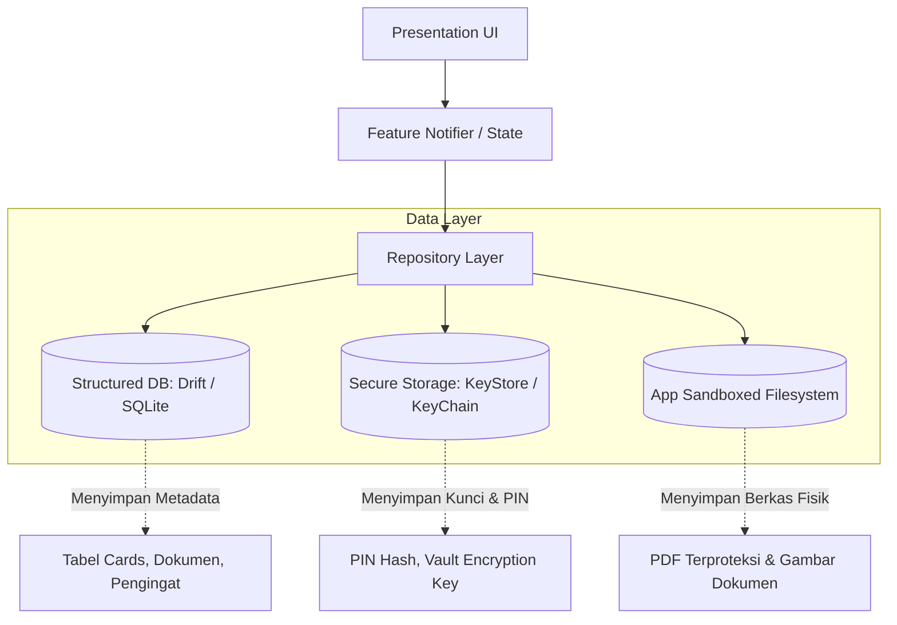
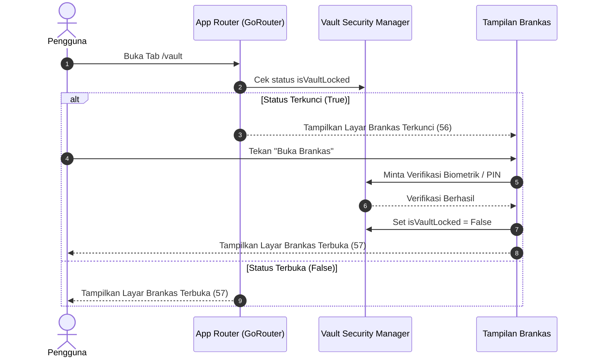
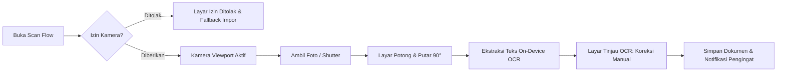

# Technical Architecture Document - Cardly

## 1. Architecture Overview

| Atribut | Detail |
|---|---|
| **Aplikasi** | Cardly (Mobile Personal Organizer & Private Space) |
| **Framework Target** | Flutter 3.47.5 (Channel Stable) |
| **Bahasa Pemrograman** | Dart 3.13.4 (Null Safety Enabled) |
| **Platform Target** | iOS & Android (Mobile Focused) |
| **Status Repositori Saat Ini** | **Greenfield / Pra-Implementasi** (Repositori belum diinisialisasi kode Flutter; baru berisi artefak desain `docs/`) |
| **Konektivitas Sistem** | **Offline-First**. Tidak bergantung pada backend cloud eksternal pada versi awal (v1.0). Seluruh persistensi data berada secara lokal di perangkat. |
| **Hubungan Dokumen** | Mengimplementasikan kebutuhan bisnis di [PRD.md](file:///Users/macbookair/Documents/Herd/cardly/PRD.md) dan menerjemahkan fidelitas visual dari [DESAIN.md](file:///Users/macbookair/Documents/Herd/cardly/DESAIN.md). |

---

## 2. Architecture Principles

1. **Separation of Concerns:** Pemisahan tegas antara lapisan UI Presentation, Application Logic / State Management, Domain/Entity, dan Lapisan Akses Data (Repository).
2. **Offline-First & Data Sovereignty:** Data pengguna adalah milik pribadi pengguna seutuhnya. Seluruh operasi CRUD wajib berfungsi tanpa internet.
3. **Secure-by-Design:**
   - Kredensial rahasia (PIN aplikasi, token kunci enkripsi) disimpan di hardware secure enclave via secure storage.
   - Penyamaran data sensitif (masking 4 digit kartu) ditegakkan sejak tingkat model data, bukan hanya manipulasi UI string.
   - Proteksi tampilan di latar belakang (*App Switcher Privacy Shield*).
4. **Predictable & Reactive State:** Alur data searah (*unidirectional data flow*), meminimalkan mutasi data liar dan mencegah *race conditions*.
5. **Simplicity over Over-Engineering:** Menghindari abstraksi berlapis yang berlebihan (*boilerplate bloat*). Gunakan struktur yang bersih, mudah diuji, dan modular.
6. **Incremental Implementation:** Arsitektur dirancang modular agar setiap fitur (Kartu, Dokumen, Scan, Brankas) dapat dibangun dan diuji secara independen tanpa ketergantungan melingkar (*no circular dependencies*).

---

## 3. Current Architecture Audit

### 3.1 Status Kode Aktual [TERVERIFIKASI]
- **Kondisi Direktori:** Repositori saat ini hanya memuat folder aset desain `docs/` dengan 147 file PNG dan file sistem `.DS_Store`.
- **Source Code (`lib/`):** Belum ada.
- **Konfigurasi (`pubspec.yaml`, `analysis_options.yaml`):** Belum ada.
- **Git Repository:** Belum diinisialisasi (`.git` belum ada di root).
- **Environment:** Flutter SDK 3.47.5 dan Dart SDK 3.13.4 telah terinstal dan terverifikasi aktif pada sistem pengembang.

### 3.2 Analisis Kesiapan
Karena belum ada kode warisan (*legacy code*), Cardly berada pada posisi ideal untuk menerapkan arsitektur bersih (*Clean Modular Architecture*) sejak baris kode pertama tanpa perlu melakukan *refactor* atau membuang kode usang.

---

## 4. Target Architecture

Cardly mengadopsi pola **Feature-First Clean Architecture** yang disesuaikan untuk aplikasi Flutter berorientasi offline:

```
┌────────────────────────────────────────────────────────┐
│                   PRESENTATION LAYER                   │
│   (Screens / Views, Widgets Reusable, Theme, States)   │
└───────────────────────────▲────────────────────────────┘
                            │ Dispatches Events / Listens State
┌───────────────────────────┴────────────────────────────┐
│                    APPLICATION LAYER                   │
│      (State Notifiers / Blocs / Controllers)           │
└───────────────────────────▲────────────────────────────┘
                            │ Calls Operations
┌───────────────────────────┴────────────────────────────┐
│                      DOMAIN LAYER                      │
│       (Entities, Business Rules, Value Objects)        │
└───────────────────────────▲────────────────────────────┘
                            │ Implements Contracts
┌───────────────────────────┴────────────────────────────┐
│                       DATA LAYER                       │
│    (Repositories, Local Data Sources, DTOs, Mappers)   │
└───────────────────────────▲────────────────────────────┘
                            │ I/O Operations
┌───────────────────────────┴────────────────────────────┐
│                   INFRASTRUCTURE LAYER                 │
│  (SQLite/Drift DB, Secure Storage, Camera, Biometric)  │
└────────────────────────────────────────────────────────┘
```

### Tanggung Jawab Tiap Lapisan:
- **Presentation:** Bertanggung jawab me-render widget sesuai token di `DESAIN.md`, menangani interaksi pengguna, dan bereaksi terhadap state.
- **Application (State Management):** Mengelola siklus hidup layar, memproses validasi input, dan memanggil repository.
- **Domain:** Memuat entitas murni Dart tanpa dependensi framework Flutter (misal: aturan bahwa nomor kartu pembayaran maksimal 4 digit).
- **Data:** Menyediakan implementasi konkret repository, serialisasi data JSON/DTO, dan koordinasi cache/database.
- **Infrastructure:** Driver perangkat keras sistem operasi (Kamera, Biometrik, Local Notifications, Secure Storage).

---

## 5. Feature Modules Mapping

Struktur kode dipecah berdasarkan modul fitur mandiri (*Feature Modules*):

| Modul Fitur | Tanggung Jawab Utama | Dependensi Data | Integrasi Hardware |
|---|---|---|---|
| **Core / Foundation** | Design tokens, tema, komponen umum, utilitas format tanggal, widget base. | Tidak ada | Tidak ada |
| **Authentication** | Onboarding carousel, Welcome, alur masuk, validasi password, setup biometrik awal. | User Profile | Biometric (`local_auth`) |
| **Home / Dashboard** | Ringkasan dompet, carousel kartu pilihan, aksi cepat, pencarian global. | Cards, Documents, Reminders | Tidak ada |
| **Cards** | Wizard tambah kartu 4-langkah, katalog filter, detail, edit, arsip, dan hapus kartu. | Card Repository | Tidak ada |
| **Documents** | Manajemen berkas, pemilihan sumber (kamera/galeri/PDF/manual), penggantian file. | Document Repository, File Storage | File Picker |
| **Scan & OCR** | Viewport kamera dengan overlay bingkai, pemotongan/rotasi gambar, ekstraksi teks OCR. | Document Module | Camera, Image Editor, ML Kit |
| **Vault & Security** | Brankas terisolasi, kunci otomatis sesi, sembunyikan app switcher, reset data lokal. | Secure Storage, Database Wipe | Biometric, Hardware Keystore |
| **Reminders** | Penjadwalan pengingat, hitung mundur hari, integrasi pengingat ke dokumen. | Reminder Repository | Local Notification Scheduler |
| **Profile & Settings**| Konfigurasi tema (Terang/Gelap/Sistem), bahasa, ekspor data JSON, FAQ/Tentang. | User Preferences, Export Service | Share / File System |

---

## 6. Recommended Target Folder Structure

Berikut adalah struktur target direktori `lib/` yang direkomendasikan saat inisialisasi Flutter:

```text
lib/
├── app/
│   ├── app.dart                   # Root MaterialApp widget & global theme wiring
│   ├── app_router.dart            # Konfigurasi routing deklaratif
│   └── app_constants.dart         # Konstanta global
├── core/
│   ├── error/                     # Failure & Exception classes
│   ├── storage/                   # Secure storage & database clients
│   ├── theme/                     # Tokens dari DESAIN.md (Colors, Typography, Radius)
│   ├── utils/                     # Formatter angka, tabular numerals, date helper
│   └── widgets/                   # Reusable components (Buttons, Inputs, Cards, BottomSheets)
├── features/
│   ├── authentication/
│   │   ├── data/                  # Auth local data source & repo
│   │   ├── domain/                # Auth models & validation rules
│   │   └── presentation/          # Views (Splash, Onboarding, Login, Register, BiometricSetup)
│   ├── cards/
│   │   ├── data/                  # Card entity DTO & database table
│   │   ├── domain/                # Card model & category enums
│   │   └── presentation/          # Views (CardList, CardWizard, CardDetail, CardEdit)
│   ├── documents/
│   │   ├── data/                  # Document DTO, file manager, repo
│   │   ├── domain/                # Document model & expiry calculator
│   │   └── presentation/          # Views (DocumentList, DocumentDetail, ManualEntryView)
│   ├── home/
│   │   ├── presentation/          # Views (HomeDashboardView, GlobalSearchView, StateViews)
│   ├── profile_settings/
│   │   ├── data/                  # Settings repository & exporter
│   │   └── presentation/          # Views (ProfileView, ThemeSettingsView, ExportDataView)
│   ├── reminders/
│   │   ├── data/                  # Reminder DTO & notification scheduler
│   │   ├── domain/                # Reminder model & countdown logic
│   │   └── presentation/          # Views (ReminderListView, ReminderDetailView, ReminderFormView)
│   ├── scan/
│   │   ├── data/                  # OCR service adapter & image processor
│   │   └── presentation/          # Views (CameraScanView, CropRotateView, OcrReviewView)
│   └── vault/
│       ├── data/                  # Vault security manager & auto-lock controller
│       └── presentation/          # Views (VaultLockedView, VaultUnlockedView, SecuritySettingsView)
└── main.dart                      # Entry point, dependency initialization
```

---

## 7. Routing dan Navigation

- **Pendekatan Rekomendasi:** **GoRouter** (Routing deklaratif berbasis URL/path yang terintegrasi dengan Flutter Router API v2).
- **Alasan Pemilihan:**
  - Mendukung navigasi bertingkat (*StatefulShellRoute*) untuk 5 Tab Bar Bawah tanpa me-rebuild halaman saat berpindah tab.
  - Mendukung *Navigation Guards* (Redirection logic) untuk mengarahkan pengguna ke layar Kunci Biometrik/PIN jika sesi Brankas atau sesi aplikasi terkunci.
  - Penanganan parameter strongly-typed saat berpindah ke detail kartu (`/cards/:id`) atau dokumen (`/documents/:id`).

### Rute Utama Aplikasi:
```text
/splash                         -> SplashView
/onboarding                     -> OnboardingView
/welcome                        -> WelcomeView
/login                          -> LoginView
/register                       -> RegisterView
/security-gate                  -> AppLockView (PIN/Biometrik)

/shell                          -> MainScaffoldWithBottomNav (StatefulShellRoute)
  ├── /home                     -> HomeDashboardView
  │   ├── /home/search          -> GlobalSearchView
  │   └── /home/notifications   -> NotificationsCenterView
  ├── /cards                    -> CardListView
  │   ├── /cards/add            -> CardCreateWizardView (Step 1-4)
  │   └── /cards/:id            -> CardDetailView
  ├── /documents                -> DocumentListView
  │   ├── /documents/add        -> AddDocumentSourceView
  │   ├── /documents/:id        -> DocumentDetailView
  │   └── /documents/scan       -> CameraScanFlowView (Scan -> Crop -> OCR)
  ├── /vault                    -> VaultGateView (Locked <-> Unlocked)
  │   └── /vault/security       -> SecuritySettingsView
  └── /profile                  -> ProfileDashboardView
      ├── /profile/theme        -> ThemeSettingsView
      ├── /profile/export       -> ExportDataView
      └── /profile/backup       -> BackupSettingsView
```

---

## 8. State Management

- **Pilihan Utama Target:** **Riverpod** (atau **flutter_bloc**)
- **Analisis Trade-Off:**
  - *Riverpod:* Bersih, aman terhadap compile-time, tidak bergantung pada `BuildContext` untuk pembacaan logika, manajemen auto-dispose otomatis untuk menghemat memori pada kamera dan formulir bertahap.
  - *Bloc:* Sangat ketat dan terstruktur dengan event-state eksplisit, namun membutuhkan lebih banyak file boilerplate.
- **Rekomendasi Arsitektur:** **Riverpod** (Notifier / AsyncNotifier) karena sangat selaras dengan kebutuhan pembagian state modular Cardly (misal: `themeModeProvider`, `vaultLockStateProvider`, `cardListNotifierProvider`).

---

## 9. Data Architecture & Storage Strategy

Karena Cardly adalah aplikasi **Offline-First**, arsitektur persistensi lokal menjadi pilar utama:



### 9.1 Database Terstruktur: SQLite via Drift (atau sqflite)
- **Tujuan:** Menyimpan seluruh baris metadata kartu, dokumen, folder, pengingat, dan riwayat aktivitas lokal.
- **Karakteristik:** Transaksional (*ACID compliant*), mendukung relasi foreign-key, dan pencarian cepat berbasis indeks teks (*FTS / Full Text Search* untuk pencarian global).

### 9.2 Penyimpanan Rahasia: Flutter Secure Storage
- **Tujuan:** Menyimpan hash PIN aplikasi, kunci master enkripsi lokal, status aktivasi biometrik, dan preferensi privasi sensitif.
- **Platform Driver:** `KeyStore` berenkripsi hardware pada Android dan `Keychain` berenkripsi Secure Enclave pada iOS.

### 9.3 Sandbox Filesystem (File Dokumen Fisik)
- Seluruh file gambar hasil scan atau impor PDF disalin ke `getApplicationDocumentsDirectory()`.
- Berkas di direktori ini tidak terindeks oleh galeri media publik ponsel (privat bagi aplikasi Cardly).
- Jika dokumen berstatus "Pribadi" (Brankas), file disarankan dienkripsi simetris menggunakan AES-256 sebelum ditulis ke disk (*Encrypted at rest*).

---

## 10. Security Architecture

1. **App Switcher Privacy Shield:**
   - Menggunakan platform channel atau listener siklus hidup `AppLifecycleState.inactive` / `paused`.
   - Segera menampilkan overlay layar netral berlogo Cardly (`docs/1. Cover.png`) saat pengguna membuka tampilan multitasking perangkat, mencegah kebocoran informasi kartu/identitas kepada pihak yang mengintip layar.
2. **Kunci Otomatis (Auto-Lock Timer):**
   - Menggunakan stream deteksi interaksi pengguna global.
   - Jika tidak ada sentuhan atau aplikasi berada di latar belakang lebih dari durasi konfigurasi (misal: 60 detik), flag `isVaultLocked` diubah menjadi `true`.
3. **Pembersihan Data Menyeluruh (Zero-Trace Wipe):**
   - Saat pengguna mengonfirmasi hapus data lokal dengan mengetik teks "HAPUS":
     1. Menutup koneksi database dan menghapus file database SQLite di disk.
     2. Menghapus seluruh file lampiran di direktori dokumen aplikasi.
     3. Mengosongkan data di secure storage (`deleteAll()`).
     4. Menyetel ulang seluruh provider state ke nilai awal.
4. **Pencegahan Kebocoran Notifikasi:**
   - Notifikasi lokal pengingat masa berlaku tidak boleh memuat nomor dokumen atau data identitas pada teks notifikasi layar kunci jika opsi "Sembunyikan detail di layar kunci" aktif.

---

## 11. Platform Architecture (iOS & Android)

| Kebutuhan Platform | Implementasi Android | Implementasi iOS |
|---|---|---|
| **Sensor Biometrik** | Android BiometricPrompt API (Fingerprint / Class 3 Biometric) | LocalAuthentication Framework (Face ID / Touch ID) |
| **Izin Kamera** | `android.permission.CAMERA` di `AndroidManifest.xml` | `NSCameraUsageDescription` di `Info.plist` |
| **Keamanan Penyimpanan** | EncryptedSharedPreferences / Android Keystore | iOS Keychain Services (kSecAttrAccessibleAfterFirstUnlock) |
| **Pencegahan Screenshot (Opsional)** | `FLAG_SECURE` pada Android Window | `isSecureTextEntry` layer hack atau screen shield overlay pada `AppDelegate` |
| **Ukuran Layar Minimum** | Adaptasi dinamis untuk lebar layar 360 dp (perangkat budget Android) | Uji rasio iPhone standar (393 × 852 pt) |

---

## 12. Error Handling & Observability

- **Lapisan Error Domain:** Membedakan kegagalan bisnis dari kegagalan sistem teknis:
  - `ValidationFailure` (misal: nomor kartu melebihi 4 digit, password kurang dari 12 karakter).
  - `SecurityFailure` (misal: PIN salah, biometrik ditolak/tidak tersedia).
  - `StorageFailure` (misal: disk penuh, file tidak ditemukan).
  - `PermissionFailure` (misal: akses kamera ditolak permanen).
- **Penanganan Umpan Balik Pengguna:**
  - Menggunakan UI State resmi dari `docs/5. Home/39 Terjadi kesalahan.png` untuk error formulir atau proses.
  - Menampilkan `SnackBar` toast dengan tombol "Urungkan" untuk aksi yang dapat dibatalkan.
- **Kebijakan Logging:**
  - **Dilarang keras mencatat data pribadi pengguna:** Tidak boleh mencetak (*logging/print*) nama kartu, nomor tersamar, email, atau isi OCR ke *console* atau *logcat*.
  - Log hanya memuat trace kesalahan operasional internal (misal: `[Storage] Failed to read database row`).

---

## 13. Testing Strategy

```
           ┌───────────────────────┐
           │   Integration Tests   │  10% (Alur Kunci Brankas & E2E)
           └───────────────────────┘
         ┌───────────────────────────┐
         │       Widget Tests        │  30% (Fidelitas UI, Form & Mode Gelap)
         └───────────────────────────┘
       ┌───────────────────────────────┐
       │          Unit Tests           │  60% (Entitas, Masking, OCR Parsing, Notifier)
       └───────────────────────────────┘
```

1. **Unit Testing:**
   - Pengujian pemangkasan nomor kartu (wajib $\le 4$ digit).
   - Pengujian logika kedaluwarsa dokumen (kalkulasi sisa hari, deteksi $\le 30$ hari).
   - Pengujian parsing teks OCR ke entitas dokumen.
2. **Widget Testing:**
   - Pengujian interaksi komponen (Tombol primary, toggle password, tab bar).
   - Pengujian responsivitas pada ukuran layar 360 dp vs 393 dp.
   - Pengujian pergantian tema Terang vs Gelap.
3. **Integration Testing:**
   - Pengujian siklus penuh: Tambah Kartu $\rightarrow$ Tampil di Beranda $\rightarrow$ Detail $\rightarrow$ Arsip $\rightarrow$ Hapus.

---

## 14. Dependencies & Candidate Packages Inventory

*Catatan: Seluruh package di bawah ini berstatus **USULAN TEKNIS**. Belum ada package yang diinstal pada tahap dokumentasi fondasi ini.*

| Package Kandidat | Versi Minimum | Tujuan Fungsional | Tingkat Risiko | Alternatif & Catatan | Status |
|---|---|---|---|---|---|
| `flutter_riverpod` | ^2.6.0 | Manajemen State Terstruktur | Rendah | `provider`, `flutter_bloc` | USULAN |
| `go_router` | ^14.0.0 | Routing Deklaratif & Shell Route | Rendah | `auto_route`, Vanilla Navigator | USULAN |
| `drift` + `sqlite3_flutter_libs` | ^2.20.0 | Persistensi Database SQLite Bertipe | Rendah | `sqflite`, `hive` | USULAN |
| `flutter_secure_storage` | ^9.2.0 | Penyimpanan Kunci/PIN Terenkripsi | Rendah | Platform Channel manual | USULAN |
| `local_auth` | ^2.3.0 | Autentikasi Biometrik (Fingerprint/FaceID) | Rendah | Plugin resmi Flutter Team | USULAN |
| `camera` | ^0.11.0 | Viewport Kamera untuk Scan Dokumen | Sedang | `image_picker` (lebih sederhana) | USULAN |
| `image_cropper` | ^8.0.0 | Pemotongan & Rotasi 90° Dokumen | Sedang | Custom canvas transform | USULAN |
| `google_mlkit_text_recognition` | ^0.14.0 | On-Device Text Recognition (OCR) | Sedang | On-device model (Privat mutlak) | USULAN |
| `flutter_local_notifications` | ^18.0.0 | Notifikasi Pengingat Masa Berlaku | Rendah | Plugin standar industri | USULAN |
| `intl` | ^0.20.0 | Format Tanggal & Tabular Numerals | Sangat Rendah | Standard Dart package | USULAN |
| `lottie` | ^3.6.0 | Animasi Vektor Splash Screen (Lottie JSON) | Rendah | Rive, Flutter CustomPainter | DIGUNAKAN |
| `flutter_svg` | ^2.0.17 | Rendering Vektor Logo Header Brand (SVG) | Rendah | CustomPainter path manual | DIGUNAKAN |

---

## 15. Architecture Decision Records (ADR)

### ADR-001: Pemilihan Arsitektur Offline-First Mandiri
- **Status:** PROPOSED (Rekomendasi Baseline)
- **Konteks:** Cardly adalah aplikasi pengatur kartu dan dokumen berfokus privasi. Desain v1.0 secara tegas menyatakan *"Cadangan belum dikonfigurasi. Tidak ada sinkronisasi cloud"*.
- **Keputusan:** Mengembangkan v1.0 murni *offline-first* dengan database lokal SQLite dan secure storage tanpa ketergantungan server backend.
- **Konsekuensi:** Privasi terjamin 100%, biaya infrastruktur nol, namun sinkronisasi antar perangkat belum tersedia hingga pengguna mengekspor data secara manual.

### ADR-002: Pemilihan GoRouter untuk Navigasi Deklaratif
- **Status:** PROPOSED
- **Konteks:** Aplikasi memiliki 5 tab persisten dan alur modal multi-langkah (seperti wizard kartu 4 langkah dan alur scan dokumen).
- **Keputusan:** Menggunakan `go_router` dengan `StatefulShellRoute`.
- **Konsekuensi:** Menjaga state tab tidak ter-reset saat pengguna berpindah tab, serta memudahkan integrasi penjaga keamanan (*security guard*).

### ADR-003: On-Device OCR vs Cloud OCR
- **Status:** PROPOSED
- **Konteks:** Fitur scan dokumen membutuhkan pembacaan teks otomatis (nama dokumen, masa berlaku).
- **Keputusan:** Menggunakan model On-Device (Google ML Kit on-device) daripada Cloud API.
- **Konsekuensi:** Data gambar tidak pernah keluar dari ponsel pengguna; privasi terlindungi maksimal; performa tergantung kapabilitas perangkat keras ponsel.

### ADR-004: Penanganan Keamanan Masking Kartu
- **Status:** ACCEPTED (Didukung eksplisit oleh Desain & PRD)
- **Konteks:** Cardly melarang penyimpanan nomor kartu penuh, CVV, dan PIN perbankan.
- **Keputusan:** Field nomor kartu dibatasi maksimal 4 digit pada tingkat entity model dan skema database (`VARCHAR(4)`).
- **Konsekuensi:** Meniadakan risiko pencurian nomor kartu kredit lengkap jika perangkat pengguna diretas.

---

## 16. Architecture & System Flow Diagrams

### 16.1 Alur Navigasi & Keamanan Sesi (Session & Vault Flow)


### 16.2 Alur Pemrosesan Dokumen & OCR (Scan Flow)


---

## 17. Technical Risks & Migration Strategy

1. **Risiko Fragmentasi Kamera Android:**
   - Beragam vendor Android memiliki implementasi driver kamera berbeda.
   - *Mitigasi:* Gunakan plugin `camera` stabil atau fallback ke `image_picker` sistem jika kamera kustom mengalami kendala inisialisasi pada tipe ponsel tertentu.
2. **Strategi Inisialisasi Proyek (Next Step):**
   - Jalankan inisialisasi Flutter standar (`flutter create . --org com.cardly.app`) ketika fase implementasi telah disetujui.
   - Tambahkan rule linter ketat pada `analysis_options.yaml` (pedantic/flutter_lints).
   - Terapkan design tokens di `lib/core/theme/` sebelum membangun layar mana pun.
