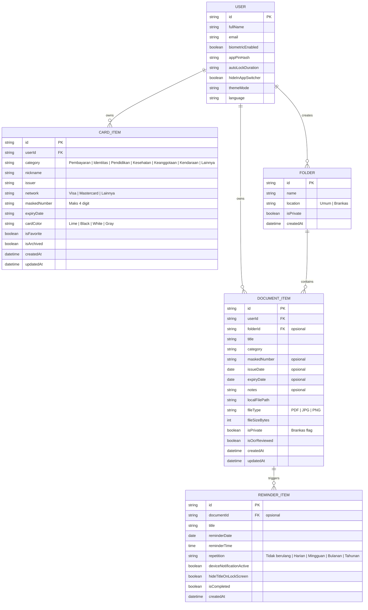

# Product Requirements Document (PRD) - Cardly

## 1. Document Control

| Atribut | Nilai |
|---|---|
| **Nama Produk** | Cardly |
| **Versi Dokumen** | 1.0.0-FOUNDATION |
| **Status Dokumen** | DRAFT / BASELINE DISCOVERY |
| **Tanggal Pembuatan** | 12 Oktober 2026 |
| **Tujuan Dokumen** | Menjadi sumber kebenaran fungsional dan batasan produk Cardly untuk tim produk, arsitek perangkat lunak, dan AI coding agent sebelum implementasi Flutter. |
| **Sumber Informasi** | 147 file artefak desain Figma di `docs/` (termasuk *Foundations*, *Components*, *Prototype Flows & Motion Spec*), audit lingkungan Flutter 3.47.5 / Dart 3.13.4, dan instruksi master prompt proyek. |
| **Klasifikasi Bukti** | **TERVERIFIKASI** (didukung langsung oleh artefak desain/sistem), **INFERENSI** (kesimpulan logis atas alur desain), **USULAN** (rekomendasi teknis), **BELUM DIKETAHUI** (belum tersedia bukti fisik), **PERLU KONFIRMASI** (keputusan bisnis/produk yang membutuhkan mandat pemilik proyek). |

### Riwayat Perubahan
| Versi | Tanggal | Penulis | Deskripsi Perubahan |
|---|---|---|---|
| 1.0.0-FOUNDATION | 12 Okt 2026 | Product Analyst & Architecture Team | Pembuatan fondasi PRD awal berdasarkan audit 147 file desain Figma dan status repositori kosong. |

---

## 2. Product Overview

### 2.1 Definisi Produk [TERVERIFIKASI]
**Cardly** adalah aplikasi *personal organizer & private space* untuk perangkat seluler yang berfungsi mengelola metadata kartu, arsip dokumen pribadi, dan pengingat masa berlaku secara terpusat, aman, dan privat di tangan pengguna.

Slogan resmi produk: *"Yang penting. Tetap pribadi."* / *"Your cards. Your documents. One private space."* (Sumber: `docs/1. Cover.png`).

### 2.2 Batasan Eksplisit Produk (Bukan Bank & Bukan Alat Pembayaran) [TERVERIFIKASI]
Berdasarkan *disclaimer* resmi yang tercetak eksplisit di layar `docs/4. Authentication/05 Welcome.png`, `docs/6. Cards/15 Tambah kartu • Detail.png`, `docs/11. Profile and Settings/35 Informasi privasi.png`, dan `docs/12. Prototype Flows/Prototype Flows & Motion Spec.png`:
1. **Bukan Bank / Bukan Dompet Digital / Bukan Pemroses Pembayaran:** Cardly sama sekali tidak memproses transaksi keuangan, kliring, transfer uang, atau pembayaran.
2. **Larangan Penyimpanan Kredensial Pembayaran:** Cardly secara tegas melarang penyimpanan CVV/CVC, PIN kartu perbankan, atau kode sandi perbankan. Untuk kartu pembayaran, aplikasi **hanya** menyimpan mask metadata: 4 digit terakhir, nama panggilan, penerbit, jaringan (Visa/Mastercard), dan masa berlaku opsional.
3. **Bukan Verifikator Keaslian Identitas Resmi:** Cardly tidak menerbitkan identitas resmi atau memvalidasi keabsahan hukum identitas pengguna kepada instansi pemerintah.
4. **Offline-First & Transparansi Penyimpanan:** Desain v1.0 secara tegas menyatakan *"Cadangan belum dikonfigurasi. Tidak ada sinkronisasi cloud atau cadangan otomatis"* (`docs/11. Profile and Settings/71 Pengaturan cadangan.png`). Data sepenuhnya disimpan secara lokal di perangkat hingga pemilik proyek memutuskan integrasi cloud.

### 2.3 Masalah Pengguna yang Diselesaikan [INFERENSI]
- Kebutuhan mencatat dan mengingat berbagai nomor referensi kartu penting (KTP, SIM, BPJS, kartu keanggotaan, kartu perpustakaan, kartu debit/kredit untuk e-commerce) tanpa harus membawa fisik semua kartu.
- Risiko keamanan dan privasi ketika foto identitas atau berkas penting disimpan bercampur di galeri foto biasa perangkat tanpa enkripsi dan perlindungan akses.
- Seringnya dokumen legal atau lisensi kedaluwarsa tanpa disadari (misal: SIM, polis asuransi, paspor) akibat tidak adanya pengingat tenggat waktu yang terintegrasi langsung dengan metadata berkas.

---

## 3. Product Vision

### 3.1 Visi Inti [TERVERIFIKASI]
Menciptakan ruang penyimpanan pribadi digital yang tenang, jelas tanpa dekorasi berlebihan (*"Jelas tanpa berlebihan"*), konsisten dalam mode terang maupun gelap, dan menjunjung transparansi privasi tanpa klaim palsu keamanan.

### 3.2 Visi Tambahan [USULAN / PERLU KONFIRMASI]
- Menyediakan enkripsi lokal *AES-256-GCM* berbasis *hardware-backed keystore/keychain* (Secure Enclave / Android Keystore) untuk berkas yang ditandai masuk "Brankas".
- Opsi sinkronisasi terenkripsi *end-to-end* (E2EE) terdesentralisasi atau multi-cloud di masa mendatang jika pengguna menghendaki cadangan multi-perangkat.

---

## 4. Target Users

| Tipe Pengguna | Tujuan | Kebutuhan Utama | Hambatan / Pain Points | Tingkat Kepastian |
|---|---|---|---|---|
| **Privacy-Conscious Mobile User** | Menata kartu dan berkas identitas di satu tempat tanpa takut data bocor atau diunggah ke pihak ketiga. | Penyimpanan data lokal, masking angka kartu, proteksi biometrik/PIN aplikasi, privasi di *app switcher*. | Aplikasi dompet digital lain meminta akses kontak/keuangan atau mengunggah data sensitif ke cloud. | TERVERIFIKASI (didukung desain privasi & keamanan) |
| **Everyday Organizer / Professional** | Cepat menemukan 4 digit kartu, nomor anggota, atau lampiran PDF saat mengisi formulir. | Pencarian instan (nama/kategori/tag), filter folder, pratinjau dokumen cepat. | Berkas tercecer di folder unduhan WhatsApp, email, dan galeri foto. | TERVERIFIKASI (didukung desain pencarian & filter) |
| **Expiry Tracker User** | Tidak ingin terlewat masa perpanjangan SIM, paspor, atau sertifikat kerja. | Pengingat berbatas waktu (H-30 hari, dsb.), notifikasi perangkat tanpa membocorkan nomor rahasia di layar kunci. | Lupa tanggal habis berlaku dokumen karena berkas fisik disimpan di lemari. | TERVERIFIKASI (didukung modul Reminders) |

---

## 5. Problem Statement

### 5.1 Masalah Terverifikasi [TERVERIFIKASI]
1. Pengguna rentan mengorbankan keamanan dengan menyimpan foto KTP/kartu di galeri umum atau aplikasi catatan yang tidak memiliki proteksi biometrik dan masking.
2. Pengguna sering membutuhkan data metadata dokumen (seperti nomor SIM, tanggal kedaluwarsa) dalam hitungan detik saat beraktivitas mobile.
3. Desain privasi yang ada di pasaran kerap membingungkan pengguna dengan janji keamanan samar atau diam-diam meminta sinkronisasi online.

### 5.2 Hipotesis Masalah [INFERENSI / PERLU KONFIRMASI]
- Pengguna enggan memakai aplikasi manajemen berkas jika proses input data harus diketik satu per satu secara manual; oleh karena itu, diperlukan alur ekstraksi OCR kamera yang tetap menjaga koreksi manual pengguna.

---

## 6. Goals dan Non-Goals

### 6.1 Goals
- **G-01 (Kerapian Visual & Akses Cepat):** Mengorganisir kartu dan dokumen digital ke dalam kategori terstruktur dengan akses kurang dari 3 ketukan dari layar utama.
- **G-02 (Perlindungan Privasi Nyata):** Menyediakan mekanisme masking (menyamarkan nomor kartu/identitas) dan autentikasi ulang (Biometrik / PIN aplikasi) saat membuka berkas di "Brankas".
- **G-03 (Pemberitahuan Proaktif):** Menampilkan banner peringatan dokumen mendekati masa kedaluwarsa dan menjadwalkan notifikasi lokal sistem.
- **G-04 (Kontrol Penuh Pengguna):** Memberikan fitur ekspor data JSON mandiri dan hapus data lokal total (*zero-trace wipe*).
- **G-05 (Konsistensi Desain Dual-Theme):** Menjamin seluruh 40+ varian layar identik secara fungsional dalam tema Terang (*Mist/White*) maupun Gelap (*Ink/Charcoal*).

### 6.2 Non-Goals & Fitur di Luar Scope [TERVERIFIKASI]
- **NG-01:** Cardly **TIDAK** memproses pembayaran, transfer uang, top-up e-money, atau integrasi gateway kartu kredit/debit.
- **NG-02:** Cardly **TIDAK** menyimpan nomor kartu penuh (16 digit), nomor CVV, PIN perbankan, atau kode OTP.
- **NG-03:** Cardly **TIDAK** menyediakan sinkronisasi cloud otomatis atau penyimpanan server terpusat pada rilis v1.0.
- **NG-04:** Cardly **TIDAK** menjamin keaslian legal dokumen hasil scan (tidak bertindak sebagai instansi penerbit e-KTP / Digital ID kenegaraan).
- **NG-05:** Cardly **TIDAK** membagikan atau menjual analitik penggunaan ke pihak ketiga (tidak ada SDK pelacak invasif).

---

## 7. Scope dan Feature Inventory

Berdasarkan audit 147 file desain dan spesifikasi alur pada `docs/12. Prototype Flows/Prototype Flows & Motion Spec.png`, berikut adalah inventaris fitur lengkap:

| ID | Fitur | Tujuan Pengguna | Bukti Desain | Status Implementasi | Prioritas | Dependensi |
|---|---|---|---|---|---|---|
| **AUTH-001** | Splash & Pengenalan Produk | Mengenal proposisi nilai Cardly (*Your cards. Your documents*) sebelum masuk. | `docs/4. Authentication/01 Splash.png`, `docs/12. Prototype Flows/Motion/Splash demonstration.png` | planned | P0 | Tidak ada |
| **AUTH-002** | Onboarding Carousel | Memahami fitur Kartu, Dokumen, dan Privasi dalam 3 langkah edukatif. | `docs/4. Authentication/02-04 Onboarding • Kartu/Dokumen/Privasi.png` | planned | P1 | AUTH-001 |
| **AUTH-003** | Welcome Screen & Disclaimer | Memilih masuk atau buat akun dengan pemahaman bahwa aplikasi bukan bank. | `docs/4. Authentication/05 Welcome.png` | planned | P0 | AUTH-002 |
| **AUTH-004** | Masuk (Login Kredensial) | Masuk ke akun lokal/aplikasi menggunakan email dan kata sandi. | `docs/4. Authentication/06 Masuk.png` | planned | P0 | AUTH-003 |
| **AUTH-005** | Buat Akun & Persetujuan Ketentuan | Mendaftar ruang pribadi baru dengan indikator kekuatan kata sandi dan checkbox persetujuan privasi. | `docs/4. Authentication/07 Buat akun.png`, `43 Akun dibuat.png` | planned | P0 | AUTH-003 |
| **AUTH-006** | Pemulihan Kata Sandi | Meminta tautan atur ulang kata sandi melalui email tanpa membocorkan eksistensi akun. | `docs/4. Authentication/08 Lupa kata sandi.png`, `09 Atur ulang.png`, `41 Periksa email.png`, `42 Kata sandi diperbarui.png` | planned | P1 | AUTH-004 |
| **AUTH-007** | Aktivasi Kunci Biometrik & PIN Fallback | Mengaktifkan sidik jari/wajah bawaan perangkat atau menyiapkan PIN aplikasi jika biometrik tidak tersedia. | `docs/4. Authentication/61 Aktifkan biometrik.png`, `62 Biometrik tidak tersedia.png` | planned | P0 | AUTH-005 |
| **HOME-001** | Beranda & Ringkasan Dompet | Melihat jumlah kartu dan dokumen, status penyamaran, kartu pilihan, aksi cepat, dan berkas baru ditambahkan. | `docs/5. Home/10 Beranda • Terang.png`, `11 Beranda • Gelap.png`, `69 Beranda • 360.png` | planned | P0 | AUTH-004, CARD-001, DOC-001 |
| **HOME-002** | Pencarian Terpusat & Kategori | Menemukan kartu/dokumen berdasarkan nama, kategori, penerbit, atau tag tanpa membocorkan nomor sensitif. | `docs/5. Home/26 Pencarian.png`, `27 Hasil pencarian.png` | planned | P0 | HOME-001 |
| **HOME-003** | Global System States (Empty, Loading, Error, Success) | Memberikan umpan balik visual saat memuat, kosong, terjadi kegagalan validasi, atau aksi berhasil. | `docs/5. Home/37-40 Keadaan kosong/Memuat/Terjadi kesalahan/Berhasil.png` | planned | P0 | Fondasi UI |
| **HOME-004** | Pembuatan Folder Terstruktur | Mengelompokkan dokumen ke dalam folder kategori umum atau folder pribadi di Brankas. | `docs/5. Home/58 Buat folder.png` | planned | P1 | HOME-001, DOC-001 |
| **CARD-001** | Katalog Kartu Saya | Menampilkan daftar seluruh kartu yang tersimpan dengan filter kategori (Pembayaran, Identitas, Pendidikan, Kesehatan, Keanggotaan, Kendaraan, Lainnya). | `docs/6. Cards/12 Kartu Saya.png`, `13 Kartu Saya • Kosong.png` | planned | P0 | HOME-001 |
| **CARD-002** | Tambah Kartu Bertahap (4 Langkah) | Input kartu melalui alur: (1) Kategori, (2) Metadata detail (4 digit, penerbit, expired), (3) Pratinjau tampilan warna kartu, (4) Ringkasan & konfirmasi. | `docs/6. Cards/14-16, 44, 45, 46` | planned | P0 | CARD-001 |
| **CARD-003** | Detail & Edit Kartu | Melihat metadata kartu tersamar, riwayat aktivitas lokal, mengedit data, atau menandai favorit. | `docs/6. Cards/17 Detail kartu.png`, `18 Edit kartu.png` | planned | P0 | CARD-001 |
| **CARD-004** | Pengarsipan & Penghapusan Kartu | Mengarsipkan kartu (dapat diurungkan via toast) atau menghapus permanen dengan modal dialog konfirmasi. | `docs/6. Cards/19 Hapus kartu • Konfirmasi.png`, `47 Arsipkan kartu.png`, `48 Perubahan belum disimpan.png` | planned | P0 | CARD-003 |
| **DOC-001** | Daftar & Detail Dokumen | Melihat daftar berkas dokumen, filter kategori, badge peringatan dokumen mendekati kedaluwarsa, dan pratinjau tersamar. | `docs/7. Documents/20 Dokumen.png`, `24 Detail dokumen.png` | planned | P0 | HOME-001 |
| **DOC-002** | Input Dokumen Multi-Sumber | Menambah dokumen via (1) Scan kamera, (2) Impor gambar galeri, (3) Impor PDF, atau (4) Isi metadata manual. | `docs/7. Documents/21 Tambah dokumen.png`, `53 Konfirmasi dokumen.png`, `54 Dokumen tersimpan.png`, `55 Detail dokumen manual.png` | planned | P0 | DOC-001 |
| **DOC-003** | Buka Dokumen Pribadi (Autentikasi Ulang) | Meminta verifikasi biometrik / PIN aplikasi sebelum membuka pratinjau penuh berkas bertanda pribadi. | `docs/7. Documents/25 Buka dokumen pribadi.png` | planned | P0 | DOC-001, VAULT-001 |
| **DOC-004** | Penggantian Berkas & Penghapusan Dokumen | Mengganti lampiran file dengan tetap mempertahankan metadata, atau menghapus permanen dengan konfirmasi. | `docs/7. Documents/59 Ganti berkas • Konfirmasi.png`, `60 Hapus dokumen.png` | planned | P1 | DOC-001 |
| **SCAN-001** | Alur Scan Kamera & Penanganan Izin | Mengambil foto dokumen fisik dengan panduan bingkai, izin kamera, dan fallback impor jika izin ditolak. | `docs/8. Scan Flow/22 Scan dokumen.png`, `49 Sebelum scan.png`, `50-51 Izin kamera.png` | planned | P1 | DOC-002 |
| **SCAN-002** | Potong & Putar (*Crop & Rotate*) | Merapikan sudut dokumen dan memutar 90 derajat sebelum proses pembacaan teks. | `docs/8. Scan Flow/52 Potong & putar.png` | planned | P1 | SCAN-001 |
| **SCAN-003** | Tinjau Hasil OCR & Koreksi Manual | Membaca metadata dokumen (nama, nomor tersamar, tanggal terbit, masa berlaku) dengan peringatan bahwa isian OCR wajib ditinjau manusia. | `docs/8. Scan Flow/23 Tinjau hasil OCR.png` | planned | P1 | SCAN-002 |
| **VAULT-001** | Brankas Terkunci & Buka Brankas | Ruang isolasi dokumen berklasifikasi pribadi tinggi yang tertutup secara default dan memerlukan biometrik/PIN. | `docs/9. Vault and Scurity/56 Brankas • Terkunci.png`, `57 Brankas • Terbuka.png` | planned | P0 | AUTH-007 |
| **VAULT-002** | Pengaturan Keamanan & Kunci Otomatis | Mengatur jeda waktu kunci otomatis (misal: 1 menit tidak aktif), opsi sembunyikan tampilan di *app switcher*, dan ubah PIN. | `docs/9. Vault and Scurity/32 Keamanan.png` | planned | P0 | VAULT-001 |
| **VAULT-003** | Hapus Data Lokal & Hapus Akun | Menghapus seluruh data perangkat secara permanen dengan mengetik kata konfirmasi "HAPUS", atau menghapus akun terdaftar. | `docs/9. Vault and Scurity/63 Hapus data lokal.png`, `64 Hapus akun.png` | planned | P0 | VAULT-002 |
| **REM-001** | Manajemen Pengingat Kedaluwarsa | Menampilkan daftar pengingat mendatang, detail hitung mundur hari (*30 hari lagi*), dan membuat pengingat tertaut dokumen. | `docs/10. Reminders/28 Pengingat.png`, `29 Detail pengingat.png`, `66 Buat pengingat.png`, `67 Edit pengingat.png` | planned | P0 | DOC-001 |
| **SET-001** | Profil Pengguna & Edit Akun | Menampilkan nama pengguna, email, avatar inisial, dan mengubah nama/email dengan konfirmasi. | `docs/11. Profile and Settings/30 Profil.png`, `31 Edit profil.png` | planned | P1 | AUTH-005 |
| **SET-002** | Preferensi Tampilan (Tema) | Memilih tema Terang, Gelap, atau Mengikuti Sistem (*system default*). | `docs/11. Profile and Settings/33 Tampilan.png` | planned | P0 | Fondasi UI |
| **SET-003** | Ekspor Data Mandiri (JSON) | Memilih cakupan ekspor data (metadata kartu, dokumen, berkas fisik) ke dalam format JSON lokal dengan autentikasi ulang. | `docs/11. Profile and Settings/34 Ekspor data.png`, `65 Konfirmasi ekspor.png` | planned | P1 | VAULT-002 |
| **SET-004** | Pengaturan Notifikasi & Privasi Layar Kunci | Mengaktifkan izin notifikasi dan toggle "Sembunyikan detail di layar kunci" agar nomor dokumen tidak bocor di bar notifikasi OS. | `docs/11. Profile and Settings/68 Notifikasi.png` | planned | P0 | REM-001 |
| **SET-005** | Pilihan Bahasa | Mengubah bahasa antarmuka aplikasi (Bahasa Indonesia dan English). | `docs/11. Profile and Settings/70 Bahasa.png` | planned | P1 | Fondasi UI |
| **SET-006** | Informasi Privasi, Bantuan, & Status Cadangan | Menampilkan transparansi penanganan data, FAQ interaktif, dan status konfigurasi cadangan. | `docs/11. Profile and Settings/35 Informasi privasi.png`, `36 Bantuan.png`, `71 Pengaturan cadangan.png`, `72 Tentang Cardly.png` | planned | P1 | Tidak ada |

---

## 8. User Stories

### US-AUTH-01: Masuk ke Ruang Pribadi
- **Sebagai** pengguna terdaftar Cardly,
- **Saya ingin** memasukkan email dan kata sandi pada form masuk,
- **Sehingga** saya dapat membuka akses ke data kartu dan dokumen pribadi saya.
- **Acceptance Criteria:**
  1. Input email memvalidasi format email standar RFC 5322.
  2. Input kata sandi memiliki toggle sembunyikan/tampilkan karakter (*eye icon*).
  3. Tombol "Masuk" menampilkan state memproses (*spinner/disabled*) saat verifikasi berlangsung.
  4. Pesan kesalahan ramah pengguna ditampilkan jika kredensial tidak cocok tanpa membocorkan rincian spesifik sistem.
- **Prioritas:** P0 | **Dependensi:** AUTH-004 | **Status:** planned | **Sumber:** `docs/4. Authentication/06 Masuk.png`.

### US-CARD-01: Menambahkan Kartu Pembayaran dengan Masking
- **Sebagai** pemegang kartu perbankan,
- **Saya ingin** mencatat nama panggilan kartu, penerbit, jaringan, dan 4 digit terakhir kartu,
- **Sehingga** saya dapat dengan mudah mengingat nomor referensi saat bertransaksi online tanpa menyimpan kredensial sensitif di perangkat.
- **Acceptance Criteria:**
  1. Form melarang penginputan nomor kartu melebihi 4 digit untuk field nomor tersamar.
  2. Tidak ada input untuk CVV/CVC atau PIN.
  3. Terdapat banner edukasi eksplisit: *"Tidak untuk kredensial pembayaran. Cardly tidak meminta CVV, PIN, atau nomor kartu lengkap"*.
  4. Pengguna dapat memilih varian warna kartu (Lime, Black, White, Gray) untuk representasi visual di dompet.
- **Prioritas:** P0 | **Dependensi:** CARD-002 | **Status:** planned | **Sumber:** `docs/6. Cards/15 Tambah kartu • Detail.png`, `16 Tampilan kartu.png`.

### US-DOC-01: Melindungi Dokumen Sensitif di Brankas
- **Sebagai** pemilik dokumen rahasia (seperti paspor atau ijazah),
- **Saya ingin** menandai dokumen tersebut sebagai "Dokumen Pribadi" dan memasukkannya ke Brankas,
- **Sehingga** siapa pun yang meminjam ponsel saya tidak dapat melihat isi pratinjau dokumen tanpa autentikasi biometrik/PIN.
- **Acceptance Criteria:**
  1. Dokumen bertanda pribadi menampilkan thumbnail terabstraksi/tersamar (*masked silhouette*) di daftar umum.
  2. Mengetuk "Buka dokumen pribadi" memicu dialog autentikasi biometrik sistem operasi atau PIN aplikasi fallback.
  3. Tab "Brankas" menampilkan status "Terkunci" jika sesi telah kedaluwarsa atau pengguna mengunci secara manual.
- **Prioritas:** P0 | **Dependensi:** DOC-003, VAULT-001 | **Status:** planned | **Sumber:** `docs/7. Documents/25 Buka dokumen pribadi.png`, `docs/9. Vault and Scurity/56 Brankas • Terkunci.png`.

### US-REM-01: Menerima Peringatan Kedaluwarsa Berkas
- **Sebagai** pengemudi yang memiliki SIM dengan masa berlaku terbatas,
- **Saya ingin** melihat sisa hari kedaluwarsa dan menerima notifikasi sebelum SIM habis masa berlakunya,
- **Sehingga** saya memiliki waktu yang cukup untuk melakukan perpanjangan resmi.
- **Acceptance Criteria:**
  1. Kartu pengingat menampilkan hitungan hari yang jelas (*misal: "30 hari lagi"*).
  2. Pengingat dapat ditautkan langsung ke entitas dokumen (misal: `SIM A.pdf`).
  3. Notifikasi sistem yang dikirimkan ke status bar menghormati preferensi privasi layar kunci (tidak menampilkan nomor rahasia).
- **Prioritas:** P0 | **Dependensi:** REM-001, SET-004 | **Status:** planned | **Sumber:** `docs/10. Reminders/28 Pengingat.png`, `29 Detail pengingat.png`.

### US-VAULT-01: Penghapusan Data Total (*Emergency Wipe*)
- **Sebagai** pengguna yang ingin menjual ponsel atau menghapus jejak,
- **Saya ingin** melakukan penghapusan data lokal secara menyeluruh dengan konfirmasi ganda,
- **Sehingga** seluruh file dokumen, metadata, dan kunci enkripsi terhapus permanen dari memori perangkat.
- **Acceptance Criteria:**
  1. Pengguna wajib mengetikkan kata "HAPUS" secara persis ke field input konfirmasi sebelum tombol aksi aktif.
  2. Ditampilkan peringatan bahwa aksi tidak dapat diurungkan dan data yang belum diekspor akan musnah.
  3. Setelah dieksekusi, database lokal dan direktori file cache/dokumen terhapus total dan aplikasi kembali ke layar selamat datang (Welcome).
- **Prioritas:** P0 | **Dependensi:** VAULT-003 | **Status:** planned | **Sumber:** `docs/9. Vault and Scurity/63 Hapus data lokal • Konfirmasi.png`.

---

## 9. Functional Requirements (FR)

### Modul Autentikasi & Sesi
- **FR-AUTH-001:** Sistem wajib menyediakan antarmuka *Splash Screen* dengan durasi pameran brand yang stabil sebelum mengarahkan ke Onboarding atau Beranda.
- **FR-AUTH-002:** Sistem wajib menyediakan 3 tahap *Onboarding Carousel* yang dapat dilewati (*Skip/Lewati*) kapan saja langsung menuju Welcome screen.
- **FR-AUTH-003:** Form pendaftaran wajib memvalidasi panjang kata sandi minimal 12 karakter dan menyediakan indikator kekuatan kata sandi visual (Kuat / Sedang / Lemah).
- **FR-AUTH-004:** Form lupa kata sandi wajib mengirimkan umpan balik generik (*"Jika terdaftar, petunjuk akan dikirim"*) guna mencegah serangan enumerasi akun (*user enumeration*).
- **FR-AUTH-005:** Sistem wajib mendukung autentikasi biometrik sistem operasi (Fingerprint / Face ID) melalui plugin resmi, dengan PIN numerik aplikasi sebagai metode cadangan primer.

### Modul Kartu (Cards)
- **FR-CARD-001:** Sistem wajib mendukung 7 kategori kartu standar: Pembayaran, Identitas, Pendidikan, Kesehatan, Keanggotaan, Kendaraan, dan Lainnya.
- **FR-CARD-002:** Pada kategori kartu Pembayaran, field nomor kartu dibatasi secara kaku maksimum 4 digit angka terakhir.
- **FR-CARD-003:** Sistem wajib menyediakan 4 preset warna kartu: Lime (`#C8F45A`), Black (`#171717`), White (`#FFFFFF`), Gray (`#EBEBE8`).
- **FR-CARD-004:** Kartu yang diarsipkan wajib dikeluarkan dari tampilan utama dan dapat dipulihkan (*Undo*) dalam jendela waktu toast (durasi minimal 4 detik).

### Modul Dokumen & Berkas (Documents)
- **FR-DOC-001:** Sistem wajib mampu menautkan file dokumen berekstensi gambar (JPG, PNG) dan dokumen PDF.
- **FR-DOC-002:** Sistem wajib mengabstraksi thumbnail pratinjau untuk dokumen bertanda pribadi hingga pengguna melewati tantangan autentikasi.
- **FR-DOC-003:** Sistem wajib memungkinkan penggantian file lampiran (*replace file*) tanpa menghapus metadata (nama, kategori, tanggal, catatan) yang sudah diinput sebelumnya.
- **FR-DOC-004:** Sistem wajib menandai banner peringatan kuning jika terdapat setidaknya satu dokumen yang akan kedaluwarsa dalam rentang waktu $\le 30$ hari.

### Modul Scan & OCR (Scan Flow)
- **FR-SCAN-001:** Sistem wajib meminta izin kamera secara elegan dengan layar edukasi sebelum dialog izin OS muncul.
- **FR-SCAN-002:** Jika izin kamera ditolak secara permanen oleh pengguna, sistem wajib menyediakan opsi "Buka Pengaturan" dan tombol alternatif "Impor file saja" tanpa memblokir alur kerja.
- **FR-SCAN-003:** Sistem wajib menyediakan fungsi pemotongan manual dan rotasi 90 derajat searah jarum jam pada gambar hasil tangkapan kamera.
- **FR-SCAN-004:** Hasil ekstraksi OCR wajib ditempatkan pada field formulir yang dapat diedit secara bebas oleh pengguna, disertai badge "Ditinjau pengguna - belum terverifikasi".

### Modul Brankas & Keamanan (Vault & Security)
- **FR-VAULT-001:** Sistem wajib mengunci akses Brankas secara otomatis ketika aplikasi berada di latar belakang (*backgrounded*) lebih dari durasi ambang batas (default: 1 menit tidak aktif).
- **FR-VAULT-002:** Sistem wajib menyediakan fitur *Privacy Shield* di *App Switcher* perangkat (tampilan layar disamarkan menjadi permukaan netral berlogo Cardly saat beralih antar aplikasi).
- **FR-VAULT-003:** Aksi penghapusan data lokal wajib mensyaratkan validasi teks "HAPUS" secara persis (case-sensitive / uppercase matching).

### Modul Pengingat (Reminders)
- **FR-REM-001:** Pengingat wajib dapat dikonfigurasi berdasarkan tanggal, jam spesifik, dan frekuensi perulangan (Tidak berulang / Harian / Mingguan / Bulanan / Tahunan).
- **FR-REM-002:** Sistem wajib mengintegrasikan pengingat dengan notifikasi lokal sistem operasi (*local notification scheduler*).
- **FR-REM-003:** Sistem wajib menghormati toggle "Sembunyikan detail di layar kunci", di mana judul notifikasi diubah menjadi teks generik (misal: *"Cardly: Pengingat dokumen"* tanpa mencantumkan nama spesifik atau nomor).

---

## 10. Non-Functional Requirements (NFR)

### 10.1 Performa & Efisiensi [USULAN TARGET TEKNIS]
- **NFR-PERF-01:** Waktu peluncuran dingin (*Cold Start*) aplikasi menuju antarmuka interaktif Beranda harus di bawah 1,5 detik pada perangkat acuan kelas menengah.
- **NFR-PERF-02:** *Frame rate* transisi layar dan pengguliran daftar (*list scrolling*) stabil pada 60 fps (atau 120 fps pada layar ProMotion) tanpa *jank*.
- **NFR-PERF-03:** Ukuran penyimpanan metadata lokal tidak boleh melebihi 50 MB (di luar file lampiran PDF/gambar yang disimpan pengguna).

### 10.2 Keamanan & Privasi [TERVERIFIKASI & USULAN ARSITEKTUR]
- **NFR-SEC-01:** Seluruh metadata sensitif dan file dokumen di ruang pribadi wajib disimpan dalam sandbox direktori privat aplikasi (*Application Documents Directory*), terisolasi dari akses aplikasi lain di perangkat.
- **NFR-SEC-02:** Kunci enkripsi atau PIN aplikasi tidak boleh disimpan dalam format teks biasa (*plaintext*). Kunci wajib disimpan di Android Keystore / iOS Keychain.
- **NFR-SEC-03:** Aplikasi wajib menonaktifkan *screen caching* sistem operasi di pengalih aplikasi (*app switcher*) saat opsi privasi aktif.

### 10.3 Keandalan & Offline Behavior [TERVERIFIKASI]
- **NFR-REL-01:** Aplikasi harus berfungsi 100% secara offline tanpa memerlukan koneksi jaringan internet untuk seluruh fitur inti (Manajemen Kartu, Dokumen, Brankas, Pengingat).
- **NFR-REL-02:** Perubahan data harus disimpan secara transaksional (*atomic write*) untuk mencegah korupsi data jika aplikasi dihentikan mendadak oleh sistem operasi.

### 10.4 Aksesibilitas & Responsivitas [TERVERIFIKASI]
- **NFR-ACC-01:** Seluruh elemen interaktif (tombol, baris daftar, tab bar) memiliki area sentuh (*tap target*) minimum $44 \times 44$ dp sesuai standar aksesibilitas seluler.
- **NFR-ACC-02:** Aplikasi wajib mendukung adaptasi tata letak layar lebar minimal 360 dp hingga 393 dp tanpa teks terpotong (*text overflow*) atau komponen bertumpuk (`docs/5. Home/69 Beranda • 360.png`).
- **NFR-ACC-03:** Kontras warna teks memenuhi standar WCAG AA (misal: warna teks primer `#171717` di atas latar `#F5F5F3` atau teks `#FFFFFF` di atas `#171717`).

---

## 11. Data dan Domain Model

Berdasarkan formulir dan tampilan data pada desain, entitas utama Cardly didefinisikan sebagai berikut:

---

## 12. Security dan Privacy Requirements

1. **Prinsip *Zero-Knowledge* & Transparansi:** Cardly memposisikan diri sebagai manajer metadata privat. Aplikasi tidak pernah mengirim data dokumen ke server analisis eksternal.
2. **Kompensasi Ketiadaan Backend:** Otentikasi saat ini adalah kontrol akses berbasis perangkat (*device-level access control*). Jika backend belum terpasang, autentikasi berfungsi sebagai pelindung gerbang lokal (*local gatekeeper*).
3. **Pembersihan Metadata File:** Saat pengguna mengimpor file gambar/PDF dari perangkat, file lampiran disalin ke dalam direktori internal terproteksi aplikasi dan tidak boleh ditinggalkan di folder *cache* publik.
4. **Keamanan Ekspor Data:** File JSON hasil ekspor data tidak boleh dibuat secara diam-diam. Pengguna harus melalui autentikasi ulang (Biometrik/PIN), dan sistem menampilkan peringatan keamanan bahwa file ekspor memuat data pribadi yang harus disimpan di lokasi aman.

---

## 13. Acceptance Criteria dan Definition of Done (DoD)

Sebuah fitur dinyatakan **DONE** dalam siklus implementasi Cardly jika dan hanya jika:
1. **Fidelitas Desain:** Tampilan UI presisi dengan spesifikasi Figma di `DESAIN.md` (warna, radius, tipografi Inter, ikon, spacing 8-pt rhythm).
2. **Dukungan Tema Ganda:** Teruji sempurna pada Mode Terang dan Mode Gelap tanpa adanya teks kontras rendah (*unreadable contrast*).
3. **Validasi Formulir Eksplisit:** Seluruh aturan validasi (misal: batasan 4 digit kartu, minimal 12 karakter password) berjalan aktif dengan penanganan pesan error visual yang ramah.
4. **Data Terisolasi & Persisten:** Data tersimpan dengan aman di penyimpanan lokal terenkripsi/terproteksi dan tidak hilang saat aplikasi ditutup paksa.
5. **Penanganan Status Lengkap:** Layar menangani 5 keadaan antarmuka: *Loading* (skeleton), *Empty* (keadaan kosong), *Error* (kesalahan validasi/sistem), *Success* (konfirmasi/toast), dan *Normal Data*.
6. **Kepatuhan Aksesibilitas:** Target ketukan minimal $44 \times 44$ dp dan adaptif terhadap layar 360 dp hingga 393 dp.
7. **Pengujian Kode:** Unit test logika bisnis dan widget test lolos tanpa regresi.

---

## 14. Prioritization dan Roadmap

### Fase 0: Setup & Architecture Foundation (Saat Ini)
- Penulisan dokumen acuan (`PRD.md`, `AGENTS.md`, `DESAIN.md`, `ARCHITECTURE.md`).
- Audit dan verifikasi seluruh 147 file desain.
- Status: **DOKUMENTASI SELESAI & TERVALIDASI**.

### Fase 1: MVP Core Experience (P0)
- Inisialisasi struktur Flutter modular dan implementasi Design System tokens (Colors, Typography, Radius, Spacing).
- Shell Navigasi: 5 Bottom Tabs (Beranda, Kartu, Dokumen, Brankas, Profil).
- Autentikasi dasar & alur Kunci Aplikasi (PIN & Biometrik).
- CRUD Kartu Saya (Masking 4 digit & 4 tema kartu).
- Manajemen Dokumen Manual & Tampilan Berkas Lokal.
- Fitur Brankas Terkunci & Autentikasi Ulang.

### Fase 2: Enhanced Organizer & OCR (P1)
- Integrasi Alur Scan Dokumen (Kamera, Pemotongan/Rotasi, Ekstraksi OCR lokal).
- Modul Pengingat Masa Berlaku (Notifikasi lokal sistem).
- Fitur Ekspor Data JSON & Hapus Data Total (*Emergency wipe*).
- Manajemen Folder & Pencarian Global.
- Multi-bahasa (Bahasa Indonesia & English).

### Fase 3: Cloud & Advanced Sync (P2/P3 - Perlu Konfirmasi Pemilik Proyek)
- Opsi pencadangan terenkripsi E2EE (Google Drive / iCloud / WebDAV).
- Kustomisasi kategori lanjutan dan tag dinamis.

---

## 15. Risks, Assumptions, Dependencies, & Open Questions

### 15.1 Resiko Teknis & Keamanan (Risks)
- **R-01 (Kamera & OCR pada Perangkat Murah):** Kualitas kamera rendah atau pencahayaan buruk dapat menghasilkan OCR yang salah. Mitigasi: Cardly mewajibkan konfirmasi manusia sebelum data disimpan (`docs/8. Scan Flow/23 Tinjau hasil OCR.png`).
- **R-02 (Notifikasi Lokal Dibatalkan OS):** Sistem optimasi baterai agresif di beberapa vendor Android (misal: MIUI, ColorOS) dapat mematikan alarm lokal pengingat kedaluwarsa. Mitigasi: Diperlukan panduan izin latar belakang pada layar pengaturan notifikasi.

### 15.2 Asumsi (Assumptions)
- Pengguna memahami bahwa Cardly adalah manajer metadata dan bukan pengganti fisik kartu pembayaran saat berbelanja offline.
- Perangkat seluler target memiliki sistem keamanan layar (PIN OS atau Sensor Biometrik).

### 15.3 Ketergantungan Eksternal (Dependencies)
- Ketersediaan plugin Flutter yang stabil dan kompatibel dengan Dart 3.13+ untuk: Kamera, Biometrik (*local_auth*), Notifikasi Lokal (*flutter_local_notifications*), dan Penyimpanan Terproteksi (*flutter_secure_storage*).

### 15.4 Pertanyaan Terbuka & Keputusan yang Membutuhkan Pemilik Proyek (Open Questions)
1. **Model Autentikasi Awal:** Apakah v1.0 sepenuhnya menggunakan autentikasi lokal perangkat (PIN aplikasi/Biometrik tanpa akun cloud), ataukah backend otentikasi (Firebase/Supabase/Custom API) harus disiapkan sejak rilis pertama? (*Status: Perlu Konfirmasi*).
2. **Penyedia OCR:** Apakah OCR akan dijalankan 100% on-device (seperti Google ML Kit Text Recognition) demi privasi mutlak pengguna, atau menggunakan API server? (*Status: Usulan Arsitektur merekomendasikan On-Device ML Kit*).
3. **Lisensi Font Inter:** Font resmi pada spesifikasi Figma adalah *Inter*. Konfirmasi penggunaan package Google Fonts atau embedding file `.ttf` lokal pada aset Flutter (*Status: Usulan: Asset lokal offline-first*).

---

## 16. Traceability Matrix

| ID Requirement | Kategori | File Desain Sumber | Komponen UI Terkait | Dokumen Referensi |
|---|---|---|---|---|
| `AUTH-001` - `007` | Autentikasi & Onboarding | `docs/4. Authentication/*.png` | `SplashView`, `OnboardingView`, `LoginView`, `BiometricSetupView` | `DESAIN.md` Sec 6.1 |
| `HOME-001` - `004` | Beranda & Global State | `docs/5. Home/*.png` | `HomeDashboardView`, `GlobalSearchView`, `StateViewWrapper` | `DESAIN.md` Sec 6.2 |
| `CARD-001` - `004` | Manajemen Kartu | `docs/6. Cards/*.png` | `CardListView`, `CardCreateWizard`, `CardDetailView` | `DESAIN.md` Sec 6.3 |
| `DOC-001` - `004` | Manajemen Dokumen | `docs/7. Documents/*.png` | `DocumentListView`, `DocumentDetailView`, `DocumentViewer` | `DESAIN.md` Sec 6.4 |
| `SCAN-001` - `003` | Kamera & OCR | `docs/8. Scan Flow/*.png` | `CameraScanView`, `CropRotateView`, `OcrReviewView` | `DESAIN.md` Sec 6.5 |
| `VAULT-001` - `003` | Brankas & Keamanan | `docs/9. Vault and Scurity/*.png` | `VaultLockedView`, `VaultUnlockedView`, `SecuritySettingsView` | `DESAIN.md` Sec 6.6 |
| `REM-001` | Pengingat | `docs/10. Reminders/*.png` | `ReminderListView`, `ReminderDetailView`, `ReminderFormView` | `DESAIN.md` Sec 6.7 |
| `SET-001` - `006` | Pengaturan & Profil | `docs/11. Profile and Settings/*.png` | `ProfileDashboardView`, `ThemeSelectorView`, `ExportDataView` | `DESAIN.md` Sec 6.8 |
| `SPEC-MOT-001` | Motion & Transisi | `docs/12. Prototype Flows/*.png` | Durasi 80-240ms, Kurva Ease-out, Reduced Motion | `DESAIN.md` Sec 6.8 |
