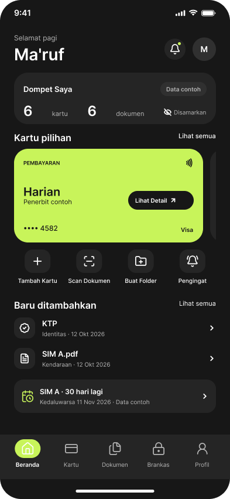
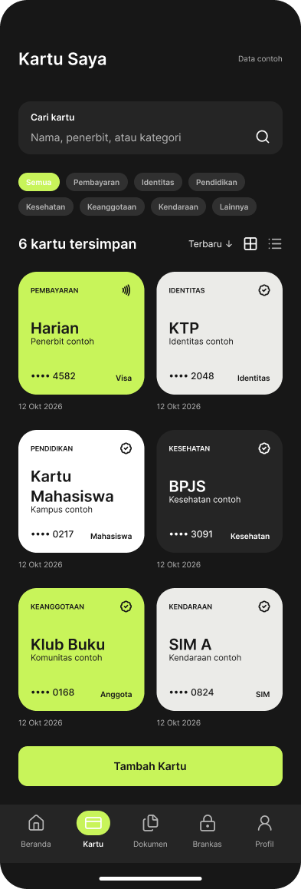
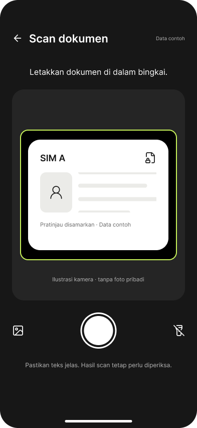
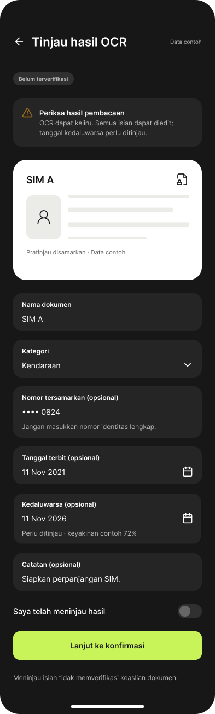
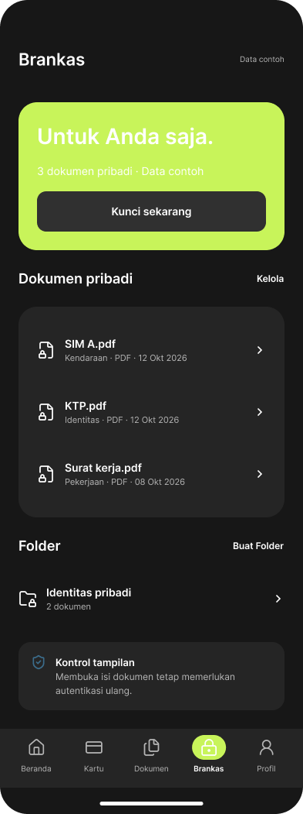
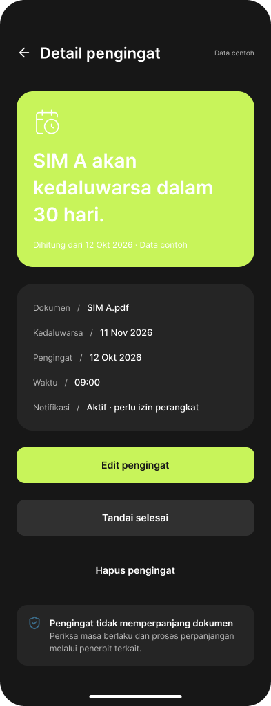
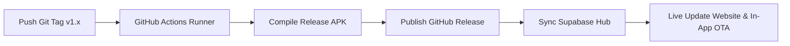

<p align="center">
  
</p>

<h1 align="center">Cardly Mobile</h1>

<p align="center">
  <strong>Your cards. Your documents. One private space.</strong><br>
  Personal Organizer & Private Space berdaulat penuh untuk kartu pembayaran, dokumen identitas resmi, dan pengingat masa berlaku dengan keamanan SQLite lokal dan sinkronisasi cloud Supabase.
</p>

<p align="center">
  <a href="https://flutter.dev"></a>
  <a href="https://dart.dev"></a>
  <a href="https://supabase.com"></a>
  <a href="https://pages.cloudflare.com"></a>
  <a href="https://cardly.suntree.my.id/download"></a>
  <a href="https://github.com/Mrmarc-bit/cardly_apps/releases"></a>
  <a href="LICENSE"></a>
</p>

---

## 📱 Ringkasan Proyek

**Cardly** dirancang untuk mengatasi fragmentasi penyimpanan kartu fisik dan dokumen pribadi tanpa mengorbankan privasi. Dibangun dengan paradigma **Local-First**, seluruh berkas dan metadata sensitif disimpan di dalam database lokal SQLite terenkripsi pada perangkat Anda. 

Dilengkapi teknologi **In-App Auto-Update OTA (Over-The-Air)**, Cardly mendistribusikan pembaruan secara mandiri melalui GitHub Releases dan Supabase Hub tanpa bergantung pada Google Play Store.

### Tautan Resmi:
* 🌐 **Situs Resmi:** [https://cardly.suntree.my.id](https://cardly.suntree.my.id)
* 📥 **Portal Unduh Langsung APK:** [https://cardly.suntree.my.id/download](https://cardly.suntree.my.id/download)
* 📦 **GitHub Releases:** [https://github.com/Mrmarc-bit/cardly_apps/releases](https://github.com/Mrmarc-bit/cardly_apps/releases)
* 🔒 **Kebijakan Privasi:** [https://cardly.suntree.my.id/privacy](https://cardly.suntree.my.id/privacy)
* 📜 **Ketentuan Layanan:** [https://cardly.suntree.my.id/terms](https://cardly.suntree.my.id/terms)

---

## 📸 Cuplikan Antarmuka (UI Showcase)

<div align="center">
  <table>
    <tr>
      <td width="33%" align="center">
        <br><br>
        <strong>1. Beranda Utama</strong><br>
        <em>Ringkasan kartu & status dokumen</em>
      </td>
      <td width="33%" align="center">
        <br><br>
        <strong>2. Dompet Kartu</strong><br>
        <em>Tumpukan kartu dinamis & interaktif</em>
      </td>
      <td width="33%" align="center">
        <br><br>
        <strong>3. Pemindai ISO ID-1</strong><br>
        <em>Laser overlay & auto-crop kartu</em>
      </td>
    </tr>
    <tr>
      <td width="33%" align="center">
        <br><br>
        <strong>4. Ekstraksi OCR Pintar</strong><br>
        <em>Pembacaan teks e-KTP & kartu otomatis</em>
      </td>
      <td width="33%" align="center">
        <br><br>
        <strong>5. Brankas Privat</strong><br>
        <em>Perlindungan biometrik & enkripsi lokal</em>
      </td>
      <td width="33%" align="center">
        <br><br>
        <strong>6. Pengingat Kedaluwarsa</strong><br>
        <em>Notifikasi tepat waktu sebelum kadaluwarsa</em>
      </td>
    </tr>
  </table>
</div>

---

## ✨ Fitur Unggulan

| Fitur | Deskripsi |
|---|---|
| 🛡️ **Kedaulatan Data Lokal (Local-First)** | Bekerja 100% offline dengan SQLite lokal. Sinkronisasi cloud bersifat sekunder dan terenkripsi melalui Supabase. |
| 💳 **Zero Full-Card Retention** | Kebijakan nol-toleransi privasi finansial: dilarang menyimpan 16 digit lengkap, CVV, atau PIN perbankan. Hanya 4 digit terakhir yang dicatat. |
| 📷 **Pemindai ISO/IEC 7810 ID-1** | Pemindai kamera berstandar kartu identitas rounded corner dengan ekstraksi teks on-device otomatis untuk e-KTP dan kartu bank. |
| 🔐 **Brankas Terkunci Biometrik** | Perlindungan keamanan ganda dengan sensor sidik jari/Face ID dan kamuflase layar (*App Switcher Shield*) saat aplikasi diminimize. |
| ⏰ **Pengingat Masa Berlaku Pintar** | Notifikasi berkala sebelum masa berlaku kartu debit/kredit, SIM, STNK, atau paspor berakhir. |
| 🔄 **In-App Auto-Updater OTA** | Pembaruan versi otomatis langsung di dalam aplikasi yang terhubung secara realtime dengan Supabase Database Hub. |

---

## 🏗️ Arsitektur Proyek

Cardly mengadopsi prinsip **Clean Architecture** dengan modularitas per fitur (*Feature-First*) dan manajemen state reaktif menggunakan **Riverpod**:

```text
lib/
├── app/                  # Router (GoRouter), observer, dan konfigurasi aplikasi utama
├── core/                 # Infrastruktur bersama
│   ├── config/           # Konfigurasi Supabase, API endpoints, dan konstanta
│   ├── database/         # Database helper SQLite lokal
│   ├── security/         # Biometric service, screen privacy shield, secure storage
│   ├── storage/          # Local secure storage & preferences
│   ├── theme/            # Design tokens resmi Cardly (Lime #C8F45A, Ink #171717)
│   ├── utils/            # Formatters, date parser, tabular numerals
│   └── widgets/          # Komponen UI atomik dapat digunakan ulang
└── features/             # Modul independen fungsional
    ├── app_update/       # Mesin pengecekan & pengunduh OTA otomatis
    ├── auth/             # Autentikasi Google OAuth & Supabase Auth
    ├── cards/            # Manajemen kartu pembayaran & loyalti
    ├── documents/        # Pengelola dokumen penting & scan kamera
    ├── home/             # Beranda & ringkasan kartu aktif
    ├── reminders/        # Pengingat kedaluwarsa & notifikasi
    └── vault/            # Brankas privat & setelan keamanan
```

---

## 🚀 Panduan Memulai (Developer Setup)

### 1. Prasyarat Sistem
* Flutter SDK `^3.13.4` atau versi stabil terbaru
* Dart SDK `^3.x`
* Java JDK 17 (untuk kompilasi Android Gradle)
* Android Studio / VS Code dengan Flutter Plugin

### 2. Kloning Repositori
```bash
git clone https://github.com/Mrmarc-bit/cardly_apps.git
cd cardly_apps
```

### 3. Pasang Dependensi
```bash
flutter pub get
```

### 4. Jalankan Pengujian Otomatis
Seluruh logika bisnis dan layanan kritis diverifikasi melalui test suite:
```bash
flutter test
```

### 5. Menjalankan Aplikasi di Emulator / Perangkat
```bash
flutter run
```

---

## 📦 Alur Rilis Otomatis (CI/CD Pipeline)

Cardly menggunakan alur CI/CD otomatis berbasis **GitHub Actions** yang terintegrasi langsung dengan **Supabase Hub** dan **Website Cloudflare Pages**:



### Cara Merilis Versi Baru:
Cukup buat git tag baru dan push ke GitHub:
```bash
# 1. Pastikan seluruh commit rapi
git checkout main
git pull origin main

# 2. Buat tag rilis baru (contoh: v1.0.1)
git tag -a v1.0.1 -m "Release v1.0.1: Pembaruan pemindai dan stabilisasi brankas"

# 3. Push tag ke GitHub
git push origin v1.0.1
```

Secara otomatis:
1. GitHub Actions akan mengompilasi `cardly-release-v1.0.1.apk`.
2. Halaman [GitHub Releases](https://github.com/Mrmarc-bit/cardly_apps/releases) akan langsung dibuat bersama berkas APK-nya.
3. Database Supabase (`app_versions`) akan otomatis terisi dengan URL unduhan dan nomor versi baru.
4. Website [cardly.suntree.my.id/download](https://cardly.suntree.my.id/download) dan aplikasi Cardly di smartphone pengguna akan langsung mendeteksi pembaruan tersebut!

---

## 🔒 Kebijakan Keamanan & Privasi

Proyek ini mematuhi standar privasi yang ketat:
* **Zero CVV / Full PAN Retention:** Tidak ada form input atau model data yang diizinkan menampung 16 digit lengkap atau CVV.
* **Hardware-Backed Encryption:** Kunci enkripsi lokal disimpan di Secure Storage berbasis perangkat keras (Android Keystore / iOS Keychain).
* **Zero Logging Leakage:** Tidak ada log konsol yang mencetak informasi pribadi atau nomor identitas pengguna.

---

## 📄 Lisensi & Hak Cipta

Proyek ini dilisensikan di bawah lisensi terbuka [MIT License](LICENSE).

Dikembangkan dan dikelola secara independen oleh **Ma'ruf Muchlisin** ([@Mrmarc-bit](https://github.com/Mrmarc-bit)).  
Hak cipta &copy; 2026 Cardly.
